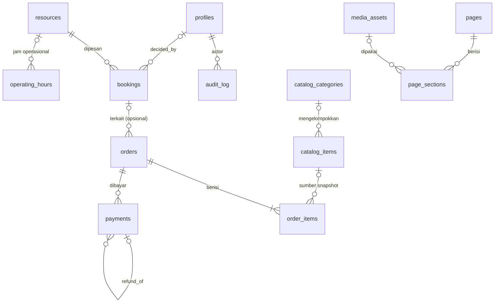

# DATABASE — Rancangan Data TITIS

> **Status:** **Draft rancangan (Phase 0)**. Belum ada migration; belum ada tabel yang direalisasikan. Seluruh nama tabel/kolom/tipe di bawah adalah **usulan konseptual**.
> **Sumber kebenaran untuk:** penjelasan entitas, relasi, status, invariants, dan alasan desain.
> **Bukan sumber kebenaran schema:** definisi yang dieksekusi adalah `supabase/migrations/*.sql`. Bila dokumen ini berbeda dari migration, hentikan pekerjaan terkait dan selesaikan konflik (`TITIS_MASTER_BUILD_GUIDE_FINAL.md` §3.2). Setelah migration ada, dokumen ini diperbarui agar menjelaskan schema yang **direalisasikan** (TITIS-013 dst.).
> **Tinjauan:** `TASK.md` → TITIS-004.
> **Label:** `OPEN-xxx` merujuk `PRD.md` §8; `DEC-xxx` merujuk `ARCHITECTURE.md` §3; `INV-xxx` adalah invariant di §8 dan menjadi rujukan test di `TESTING.md`. Kebijakan akses (RLS) **tidak** diulang di sini; lihat `SECURITY.md` §5.

---

## 1. Cara membaca dokumen ini

- Satu instalasi = satu bisnis (PRD A-1). Tidak ada kolom `business_id` pada tabel operasional; singleton `business_settings` mewakili bisnis tersebut. Bila scope berubah menjadi multi-bisnis, seluruh rancangan ini harus ditinjau ulang.
- Kolom bertanda **(kondisional)** hanya ada bila OPEN terkait memutuskannya masuk scope.
- Tipe ditulis konseptual (mis. `uuid`, `text`, `timestamptz`, `bigint`); tipe final ditentukan di migration.

## 2. Konvensi umum (Usulan)

| Topik | Konvensi |
|---|---|
| Penamaan | Tabel dan kolom `snake_case`; tabel jamak (`bookings`); foreign key `<entitas>_id`. |
| Primary key | `uuid` (dibuat server) untuk entitas operasional; `profiles.id` = `auth.users.id`. |
| Jejak waktu | Semua tabel operasional punya `created_at timestamptz not null default now()`; yang dapat berubah punya `updated_at`. |
| Pelaku | Kolom `created_by` / `decided_by` / `recorded_by` mengacu `profiles.id` pada aksi staf. |
| Penghapusan | Data keuangan dan audit **tidak pernah di-hard-delete** (§8, INV-PAY-04, INV-AUD-01). Entitas master (resource, katalog) dinonaktifkan dengan `is_active = false`, bukan dihapus, bila pernah direferensikan. |
| Nilai terbatas | Himpunan nilai (status, role, metode) memakai `text` + `CHECK` (lebih mudah dimigrasi daripada enum native). Keputusan akhir di DEC-009/DEC-010 bila perlu. |
| RLS | Setiap tabel yang dapat diakses client wajib RLS aktif (INV-ACC-03). Rinciannya di `SECURITY.md`. |
| Migration | Satu perubahan logis per file; penamaan mengikuti `supabase migration new <nama>` (timestamp otomatis). Lihat §11. |

## 3. Konvensi data

### 3.1 Identifier publik

Pengunjung tidak boleh menebak atau menghitung ID internal. Rujukan yang diberikan kepada pengunjung (mis. setelah booking) memakai `reference_code` acak yang tidak berurutan, bukan `id`.

### 3.2 Waktu dan zona waktu

- Semua instant disimpan sebagai `timestamptz` (UTC secara internal). Tidak ada `timestamp without time zone` untuk waktu kejadian.
- Zona waktu bisnis disimpan di `business_settings.timezone` (nama IANA). Batas “hari”, “minggu”, “bulan” pada laporan dan jam operasional dihitung di zona ini (OPEN-013).
- Tanggal laporan **tidak** dihitung dengan memotong UTC; selalu konversi ke zona bisnis terlebih dahulu (TEST-RPT-02, TEST-BKG-10).

### 3.3 Status

Semua status adalah `text` + `CHECK` dan hanya berubah melalui jalur yang ditetapkan di §6 (RPC/trigger), bukan lewat update kolom bebas oleh client (INV-BKG-06).

### 3.4 Uang

- **Tidak ada floating-point** untuk uang (INV-POS-05).
- Usulan (DEC-009): `bigint` yang menyimpan jumlah dalam **satuan terkecil yang dipakai bisnis**; jumlah desimal ditentukan `business_settings.currency_decimals` (mis. `0` untuk rupiah utuh, `2` untuk mata uang bersen). Mata uang di `business_settings.currency_code`. Satu mata uang per instalasi.
- Tarif pajak dan persen diskon disimpan sebagai bilangan bulat **basis points** (1% = 100 bp), bukan desimal.
- Aturan pembulatan (per baris vs per total; arah pembulatan) adalah OPEN-010 dan harus diimplementasikan di satu tempat tepercaya.

## 4. Entitas (Usulan)

### 4.1 Identitas dan pengaturan

**`profiles`** — satu baris per akun admin (Owner/Staff).

| Kolom | Tipe | Catatan |
|---|---|---|
| `id` | uuid PK | = `auth.users.id` |
| `display_name` | text | |
| `role` | text | `owner` \| `staff`. **Tidak dapat diubah oleh client** (INV-ACC-01/02); perubahan hanya lewat jalur istimewa. |
| `is_active` | boolean | `false` = akses dicabut (AC-AUTH-03.2) |
| `created_at`, `updated_at` | timestamptz | |

**`business_settings`** — singleton (INV-ACC-05).

| Kolom | Tipe | Catatan |
|---|---|---|
| `id` | boolean PK default true, `CHECK (id)` | menjamin satu baris |
| `business_name`, `tagline`, `description` | text | field publik |
| `address`, `phone`, `email`, `social_links` (jsonb) | | field publik (OPEN-006) |
| `opening_hours_display` | text/jsonb | tampilan jam buka (informasi, bukan aturan booking) |
| `timezone` | text | nama IANA (OPEN-013) |
| `currency_code`, `currency_decimals` | text, smallint | OPEN-013 |
| `default_tax_rate_bp` | integer | **(kondisional)** OPEN-010 |
| `updated_at`, `updated_by` | | |

### 4.2 Konten publik (CMS)

**`pages`**

| Kolom | Tipe | Catatan |
|---|---|---|
| `id` | uuid PK | |
| `slug` | text unique | URL halaman |
| `title` | text | |
| `status` | text | `draft` \| `published` (OPEN-006) |
| `meta_title`, `meta_description` | text | OPEN-015 |
| `published_at` | timestamptz | |
| `updated_at`, `updated_by` | | |

**`page_sections`**

| Kolom | Tipe | Catatan |
|---|---|---|
| `id` | uuid PK | |
| `page_id` | uuid FK → `pages` | `ON DELETE CASCADE` hanya untuk konten CMS |
| `section_key` | text | jenis seksi (hero, teks, daftar, ...) |
| `position` | integer | urutan |
| `content` | jsonb | **terstruktur dan terbatas** (bukan HTML bebas); skema field per `section_key` di `ARCHITECTURE.md` (DEC-014) |

**`media_assets`** *(kondisional, OPEN-006)*

| Kolom | Tipe | Catatan |
|---|---|---|
| `id` | uuid PK | |
| `storage_path` | text unique | lokasi di storage |
| `alt_text` | text | AC-CMS-03.2 |
| `mime_type`, `size_bytes` | text, bigint | batas tipe/ukuran (AC-CMS-03.1) |
| `uploaded_by` | uuid FK → `profiles` | |

### 4.3 Booking

**`resources`**

| Kolom | Tipe | Catatan |
|---|---|---|
| `id` | uuid PK | |
| `name`, `description` | text | |
| `capacity` | integer | `CHECK (capacity > 0)` |
| `is_active` | boolean | nonaktif ⇒ tidak dapat dipesan |
| `min_duration_minutes`, `max_duration_minutes`, `buffer_minutes` | integer | **(kondisional)** OPEN-007 |
| `sort_order` | integer | |

**`operating_hours`** *(kondisional, OPEN-007)* — aturan jam yang dipakai validasi booking.

| Kolom | Tipe | Catatan |
|---|---|---|
| `id` | uuid PK | |
| `resource_id` | uuid FK, nullable | `NULL` = berlaku untuk seluruh bisnis |
| `weekday` | smallint | 0–6 |
| `opens_at`, `closes_at` | time | dalam zona waktu bisnis |

**`bookings`**

| Kolom | Tipe | Catatan |
|---|---|---|
| `id` | uuid PK | |
| `reference_code` | text unique | rujukan acak untuk pengunjung (§3.1) |
| `resource_id` | uuid FK → `resources` | INV-BKG-02 |
| `requester_name`, `requester_contact` | text | data pribadi; tidak dibuka ke publik (THR-10) |
| `party_size` | integer | `CHECK (party_size > 0)` |
| `starts_at`, `ends_at` | timestamptz | `CHECK (ends_at > starts_at)` (INV-BKG-03) |
| `notes` | text | catatan pengunjung |
| `status` | text | lihat §6.1; default ditetapkan sistem (INV-BKG-01) |
| `decided_by`, `decided_at`, `decision_note` | uuid, timestamptz, text | INV-BKG-07 |
| `created_at`, `updated_at` | timestamptz | |

### 4.4 Katalog, POS, dan pembayaran

**`catalog_categories`** *(opsional)* — `id`, `name`, `sort_order`.

**`catalog_items`**

| Kolom | Tipe | Catatan |
|---|---|---|
| `id` | uuid PK | |
| `category_id` | uuid FK, nullable | |
| `name`, `description` | text | |
| `kind` | text | `product` \| `service` |
| `unit_price` | bigint | `CHECK (unit_price >= 0)`; satuan §3.4 |
| `is_active` | boolean | nonaktif ⇒ tidak dapat dijual |
| `is_publicly_listed` | boolean | tampil di public website (OPEN-006) |
| `sort_order` | integer | |

**`orders`** — satu transaksi POS.

| Kolom | Tipe | Catatan |
|---|---|---|
| `id` | uuid PK | |
| `order_number` | text unique | dihasilkan database (INV-POS-07); format OPEN-010 |
| `client_request_id` | uuid unique | kunci idempotency (INV-POS-04) |
| `status` | text | `active` \| `void` (§6.2) |
| `booking_id` | uuid FK, nullable | kaitan booking (OPEN-011) |
| `customer_name` | text, nullable | |
| `subtotal_amount`, `discount_amount`, `tax_amount`, `rounding_amount`, `total_amount` | bigint | dihitung server; `total = subtotal − discount + tax + rounding` (INV-POS-02) |
| `discount_reason` | text, nullable | wajib bila diskon > 0 (usulan) |
| `created_by` | uuid FK → `profiles` | |
| `voided_at`, `voided_by`, `void_reason` | | terisi saat void (OPEN-010) |
| `created_at` | timestamptz | |

**`order_items`**

| Kolom | Tipe | Catatan |
|---|---|---|
| `id` | uuid PK | |
| `order_id` | uuid FK → `orders` | |
| `catalog_item_id` | uuid FK, nullable | rujukan asal; **bukan** sumber nama/harga riwayat |
| `item_name_snapshot` | text | INV-POS-01 |
| `unit_price_snapshot` | bigint | INV-POS-01 |
| `quantity` | integer | `CHECK (quantity > 0)` |
| `line_total_amount` | bigint | `unit_price_snapshot × quantity` |

**`payments`** — buku catatan pembayaran, **append-only** secara bisnis (INV-PAY-04).

| Kolom | Tipe | Catatan |
|---|---|---|
| `id` | uuid PK | |
| `order_id` | uuid FK → `orders` | INV-PAY-01 |
| `client_request_id` | uuid unique | idempotency (TEST-PAY-06) |
| `kind` | text | `payment` \| `refund` |
| `purpose` | text, nullable | `deposit` \| `settlement` \| `full` — hanya label; tidak memengaruhi cara hitung |
| `amount` | bigint | `CHECK (amount > 0)`; arah ditentukan `kind` |
| `method` | text | himpunan metode OPEN-010 |
| `paid_at` | timestamptz | waktu uang diterima/dikembalikan |
| `status` | text | `recorded` \| `voided` (§6.3) |
| `refund_of_payment_id` | uuid FK, nullable | wajib bila `kind = refund` |
| `recorded_by` | uuid FK → `profiles` | |
| `note`, `created_at` | | |

### 4.5 Audit

**`audit_log`** — append-only (INV-AUD-01).

| Kolom | Tipe | Catatan |
|---|---|---|
| `id` | uuid PK | |
| `occurred_at` | timestamptz | |
| `actor_id`, `actor_role` | uuid, text | `NULL` bila aksi anonim melalui jalur publik |
| `action` | text | mis. `booking.confirm`, `payment.void`, `role.change` |
| `entity_type`, `entity_id` | text, uuid | |
| `details` | jsonb | **dibersihkan**: tanpa token/secret/data sensitif (`SECURITY.md` §8.2) |

## 5. Diagram relasi



`business_settings` adalah singleton tanpa relasi FK.

## 6. Status dan transisi (Usulan)

Himpunan status dan transisi final ditentukan OPEN-008 (booking) dan OPEN-010/011 (order/payment). Transisi di luar tabel di bawah **harus ditolak oleh database** (INV-BKG-06).

### 6.1 Booking

| Dari | Ke | Oleh | Syarat |
|---|---|---|---|
| *(baru)* | `pending` | sistem | Ditetapkan sistem saat permintaan masuk; tidak dapat diisi pemanggil (INV-BKG-01) |
| `pending` | `confirmed` | Owner/Staff berwenang (OPEN-002) | Tidak bentrok dengan booking `confirmed` lain (INV-BKG-04) |
| `pending` | `rejected` | Owner/Staff berwenang | Alasan opsional |
| `pending` | `expired` | sistem | Bila ada aturan kedaluwarsa (OPEN-008) |
| `pending` / `confirmed` | `cancelled` | Owner/Staff berwenang (pengunjung: OPEN-008) | |
| `confirmed` | `completed` | — | **Belum diputuskan** (OPEN-008): apakah status ini ada |

`rejected`, `expired`, `cancelled` adalah status akhir. Status baru (mis. `no_show`) hanya boleh ditambah melalui OPEN-008.

### 6.2 Order

| Dari | Ke | Oleh | Syarat |
|---|---|---|---|
| *(baru)* | `active` | checkout | Atomik (INV-POS-03) |
| `active` | `void` | Owner (Staff: OPEN-010) | Alasan wajib; jejak audit; perlakuan pembayaran terkait ditentukan OPEN-011 |

Status pembayaran order (`unpaid`, `partial`, `paid`, `overpaid`) **diturunkan** dari jumlah pembayaran, bukan kolom tersimpan, agar tidak bisa menyimpang dari ledger (INV-PAY-02).

### 6.3 Payment

| Dari | Ke | Oleh | Syarat |
|---|---|---|---|
| *(baru)* | `recorded` | Owner/Staff berwenang (OPEN-004) | Idempotent (INV-PAY-01) |
| `recorded` | `voided` | jalur istimewa (OPEN-004/011) | Baris tidak dihapus; nominal/relasi tidak berubah; masuk audit |

Refund dicatat sebagai baris baru `kind = refund` yang merujuk `refund_of_payment_id`; ia **tidak** mengubah baris asli.

## 7. Desain konkurensi dan idempotency (Usulan)

### 7.1 Anti-bentrok booking (DEC-007)

Pemeriksaan overlap di UI atau query sebelum insert **tidak cukup** terhadap dua permintaan bersamaan (INV-BKG-05). Usulan: *exclusion constraint* PostgreSQL pada booking berstatus `confirmed`.

```sql
-- ILUSTRASI konsep, BUKAN migration. Definisi final ada di supabase/migrations/.
create extension if not exists btree_gist;

alter table bookings
  add constraint bookings_no_overlap_confirmed
  exclude using gist (
    resource_id with =,
    tstzrange(starts_at, ends_at, '[)') with &&
  )
  where (status = 'confirmed');
```

Konsekuensi yang harus diputuskan di OPEN-009 dan diverifikasi saat TITIS-031:

- Rentang `[mulai, selesai)` memperbolehkan booking berurutan tanpa jeda (selesai = mulai berikutnya). Bila bisnis ingin buffer, jangan menambah interval langsung dalam ekspresi constraint (aritmetika interval pada `timestamptz` tidak berstatus *immutable* dan tidak dapat dipakai di sana; verifikasi di versi PostgreSQL yang dipakai). Gunakan kolom turunan yang diisi trigger/RPC.
- Pelanggaran constraint menghasilkan error `23P01` (exclusion violation) yang diterjemahkan RPC menjadi pesan yang dapat ditindaklanjuti (AC-BKG-04.4).
- Bila `pending` ikut memblokir (OPEN-009), predikat `where` dan keadaan transisi harus disesuaikan.

### 7.2 Idempotency checkout dan pembayaran (DEC-008)

`orders.client_request_id` dan `payments.client_request_id` memakai `UNIQUE`. Klien membuat UUID sekali per upaya niat pengguna dan mengirimnya ulang saat retry; RPC mengembalikan baris yang sama alih-alih membuat baru (INV-POS-04).

### 7.3 Nomor transaksi

`order_number` dihasilkan di database (sequence/counter per aturan OPEN-010), bukan di browser, agar unik dan aman konkuren (INV-POS-07).

## 8. Invariants

Setiap invariant harus ditegakkan di **database/lapisan tepercaya** (constraint, FK, trigger, RPC, RLS), bukan hanya UI. Kolom “Test” merujuk `TESTING.md`.

### 8.1 Access control

| ID | Invariant | Mekanisme (Usulan) | Test |
|---|---|---|---|
| INV-ACC-01 | Role dan keterikatan bisnis tidak dapat diubah lewat update field biasa oleh pengguna tidak berwenang. | Kolom `role` tidak termasuk yang dapat di-update client; perubahan lewat jalur istimewa. | TEST-RLS-05 |
| INV-ACC-02 | Staff tidak dapat menaikkan role dirinya. | Sama dengan INV-ACC-01 + policy/trigger penolak. | TEST-RLS-05 |
| INV-ACC-03 | Setiap tabel yang dapat diakses client memiliki RLS aktif dan policy yang teruji. | Migration + pemeriksaan katalog sistem di test. | TEST-RLS-01 |
| INV-ACC-04 | Semua jalur akses (tabel, view, RPC, Edge Function) menegakkan kontrol yang setara. | View `security_invoker`, grant eksplisit function, review jalur. | TEST-RLS-06 |
| INV-ACC-05 | Hanya ada satu baris `business_settings`. | `PRIMARY KEY` boolean + `CHECK`. | TEST-DB-05 |

### 8.2 Booking

| ID | Invariant | Mekanisme (Usulan) | Test |
|---|---|---|---|
| INV-BKG-01 | Status awal ditetapkan sistem. | Default/RPC memaksa `pending`; input pemanggil diabaikan. | TEST-BKG-01 |
| INV-BKG-02 | Resource valid, ada, dan aktif. | FK + validasi RPC. | TEST-BKG-03 |
| INV-BKG-03 | Rentang waktu valid dan zona waktu konsisten. | `CHECK (ends_at > starts_at)`, `timestamptz`, validasi jam/lead time di RPC. | TEST-BKG-03, TEST-BKG-10 |
| INV-BKG-04 | Booking `confirmed` pada resource sama tidak overlap. | Exclusion constraint (§7.1). | TEST-BKG-04, TEST-BKG-05 |
| INV-BKG-05 | Pemeriksaan overlap aman terhadap permintaan bersamaan. | Constraint di database, bukan query pra-periksa. | TEST-BKG-06 |
| INV-BKG-06 | Status hanya berubah sesuai transisi yang diizinkan. | Trigger/RPC penjaga transisi (§6.1). | TEST-BKG-07 |
| INV-BKG-07 | Konfirmasi/penolakan mencatat pelaku dan waktu. | Kolom `decided_by/at` diisi RPC; audit. | TEST-BKG-12 |

### 8.3 POS dan pembayaran

| ID | Invariant | Mekanisme (Usulan) | Test |
|---|---|---|---|
| INV-POS-01 | Item transaksi menyimpan snapshot nama dan harga. | Kolom snapshot diisi RPC dari katalog saat checkout. | TEST-POS-02 |
| INV-POS-02 | Total dihitung di lapisan tepercaya dan konsisten (`total = subtotal − diskon + pajak + pembulatan`). | RPC checkout + `CHECK` konsistensi. | TEST-POS-01, TEST-POS-05 |
| INV-POS-03 | Checkout atomik atau memiliki desain pemulihan yang jelas. | Satu transaksi database (RPC). | TEST-POS-03 |
| INV-POS-04 | Retry/double-submit tidak membuat transaksi ganda. | `UNIQUE (client_request_id)`. | TEST-POS-04 |
| INV-POS-05 | Uang tidak memakai floating-point. | Tipe `bigint`; larangan `float`/`numeric` tanpa skala di review. | TEST-POS-06 |
| INV-POS-06 | Constraint, FK, dan unique dipakai bila tepat. | Review migration + test negatif. | TEST-DB-02 |
| INV-POS-07 | Nomor transaksi unik, aman konkuren. | Sequence/counter + `UNIQUE`. | TEST-POS-09 |
| INV-PAY-01 | Pembayaran memiliki relasi, nominal > 0, waktu, metode, status. | `NOT NULL`, `CHECK`, FK. | TEST-PAY-01 |
| INV-PAY-02 | Jumlah pembayaran bersih tidak melebihi total kecuali aturan kelebihan bayar mengizinkan (OPEN-011). | Validasi RPC; status bayar diturunkan. | TEST-PAY-02, TEST-PAY-03 |
| INV-PAY-03 | DP, pelunasan, void, dan refund tidak terhitung dua kali. | Penjualan dari `orders`; kas dari `payments` (§9). | TEST-PAY-02, TEST-RPT-03 |
| INV-PAY-04 | Pembayaran append-only; koreksi lewat catatan pembalik; tanpa hard delete. | Tanpa grant/policy `DELETE`; trigger penjaga kolom. | TEST-PAY-04 |

### 8.4 Laporan dan audit

| ID | Invariant | Mekanisme (Usulan) | Test |
|---|---|---|---|
| INV-RPT-01 | Angka laporan dapat direkonsiliasi dengan baris transaksi/pembayaran. | Metrik dari view/RPC yang menghitung dari tabel dasar (§9). | TEST-RPT-01, TEST-RPT-05 |
| INV-AUD-01 | Audit log append-only; aksi sensitif tercatat. | Tanpa `UPDATE/DELETE`; trigger penolak. | TEST-DB-06 |

## 9. Katalog metrik laporan (Usulan — OPEN-012)

Aturan inti yang mencegah penghitungan ganda:

1. **Penjualan** diakui dari `orders` aktif pada tanggal order (zona bisnis). **DP dan pelunasan bukan penjualan**; keduanya pembayaran atas order yang sama.
2. **Penerimaan kas** dihitung dari `payments` pada tanggal `paid_at` (zona bisnis).
3. Order `void` dikeluarkan dari penjualan. Nasib pembayaran pada order void (refund atau dicatat hangus) ditentukan OPEN-011 dan harus eksplisit.
4. Refund mengurangi penerimaan kas pada tanggal refund, tidak mengubah penjualan kecuali disertai void/koreksi.

| ID | Metrik | Definisi (Usulan) | Sumber | Tanggal acuan |
|---|---|---|---|---|
| MET-01 | Penjualan kotor | Σ `subtotal_amount` order `active` | `orders` | tanggal order |
| MET-02 | Diskon | Σ `discount_amount` order `active` | `orders` | tanggal order |
| MET-03 | Penjualan bersih | MET-01 − MET-02 | `orders` | tanggal order |
| MET-04 | Pajak | Σ `tax_amount` order `active` | `orders` | tanggal order |
| MET-05 | Total tagihan | Σ `total_amount` order `active` | `orders` | tanggal order |
| MET-06 | Penerimaan kas | Σ `amount` payment `kind=payment`, `status=recorded` | `payments` | `paid_at` |
| MET-07 | Refund | Σ `amount` payment `kind=refund`, `status=recorded` | `payments` | `paid_at` |
| MET-08 | Penerimaan bersih | MET-06 − MET-07 | `payments` | `paid_at` |
| MET-09 | Saldo belum dibayar | Σ (`total_amount` − pembayaran bersih) order `active`, per akhir periode | `orders`, `payments` | akhir periode |
| MET-10 | Jumlah transaksi | Count order `active` | `orders` | tanggal order |
| MET-11 | Rata-rata nilai transaksi | MET-05 / MET-10 | `orders` | tanggal order |
| MET-12 | Item terlaris | Σ `quantity` per `item_name_snapshot` | `order_items` | tanggal order |
| MET-13 | Booking menurut status | Count `bookings` per `status` | `bookings` | `starts_at` |

Contoh hitung manual untuk rekonsiliasi ada di `TESTING.md` §8. Bila definisi berubah, perbarui tabel ini **dan** fixture test.

## 10. Seed dan data uji

- Data demo **sintetis**; tanpa data pelanggan asli.
- `supabase/seed.sql` dapat dijalankan ulang (idempoten) dan tidak bergantung pada ID production.
- **Tidak ada password atau secret di seed.** Akun uji (Owner/Staff) dibuat oleh skrip lokal yang membangkitkan kredensial acak saat dijalankan dan tidak menyimpannya di Git.
- Fixture edge case disiapkan sengaja: waktu bertabrakan, pembayaran parsial, transaksi gagal, record tanpa izin, nilai batas (`TESTING.md` §8).

## 11. Migration dan tipe

- Alur lokal (verifikasi sintaks CLI pada versi yang dipakai): `supabase migration new <nama>` → tulis SQL → `supabase db reset` (hanya lokal) → `supabase test db`.
- Sebelum menerapkan: tinjau SQL, dampak data, rollback/recovery, dan apakah destruktif. Migration yang menghapus/memindahkan/mengubah makna data memerlukan persetujuan (`AGENTS.md` §3.2).
- Perubahan data lama memerlukan strategi backfill/kompatibilitas; jangan hanya menambah kolom lalu mengasumsikan data lama valid.
- Tipe TypeScript yang dihasilkan dari schema disinkronkan setelah migration (DEC-010; TEST-DB-04). Tidak ada tipe buatan tangan yang menyimpang dari database.
- Referensi alur: https://supabase.com/docs/guides/local-development/database-migrations

## 12. Retensi, ekspor, dan backup

Retensi data, ekspor, dan strategi backup/pemulihan ditentukan OPEN-013 dan dirinci pada TITIS-076. Sampai itu diputuskan, tidak ada data yang dihapus otomatis.

## 13. Pertanyaan desain yang bergantung keputusan

| Pertanyaan | Opsi | Terikat |
|---|---|---|
| Di mana DP booking dicatat? | A: order dibuat saat booking dikonfirmasi dan pembayaran menempel ke order (usulan). B: `payments` menempel langsung ke booking (`booking_id` XOR `order_id`). | OPEN-011 |
| Apakah `completed` ada pada booking? | Ya / Tidak | OPEN-008 |
| Apakah `pending` memblokir slot? | Ya / Tidak | OPEN-009 |
| Apakah buffer antar-booking ada? | Ya (kolom turunan) / Tidak | OPEN-007 |
| Void order yang sudah dibayar | Wajib refund / dicatat hangus / dilarang | OPEN-011 |
| Pajak: per baris atau per total? | Per baris / per total | OPEN-010 |
