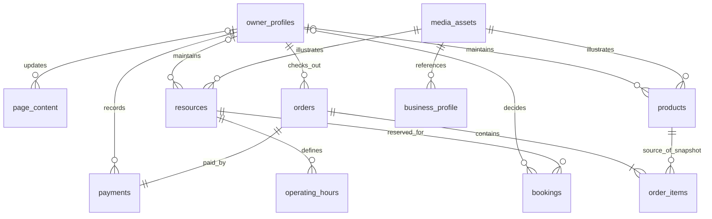

# DATABASE — Rancangan Data TITIS

> **Status:** Disetujui sebagai baseline MVP — revisi 2026-10-15, diperbarui per keputusan Owner 2026-10-16.
>
> **Baseline yang dipakai:** `PRD.md`, `TITIS_MASTER_BUILD_GUIDE_FINAL.md`, dan `ARCHITECTURE.md` revisi 2026-10-16 (DEC all Accepted).
>
> **Sumber kebenaran untuk:** entitas konseptual, relasi, status, aturan integritas data, dan alasan desain.
>
> **Bukan sumber kebenaran schema aktif:** schema yang dieksekusi ditentukan oleh `supabase/migrations/*.sql`. Bila dokumen berbeda dari migration, hentikan pekerjaan terkait dan selesaikan konflik sebelum melanjutkan.
>
> **Task review:** `TASK.md` → TITIS-007. Migration fondasi: `TASK.md` → TITIS-104; katalog dan resource direncanakan pada Phase 2; booking dan POS berada pada fase berikutnya sesuai `TASK.md`.

---

## 1. Tujuan, batas, dan aturan penggunaan

1. Satu instalasi TITIS mewakili **satu bisnis dan satu akun Owner**. Tidak ada `business_id` pada tabel operasional, multi-tenant, Staff, atau permission matrix dalam MVP.
2. Model data mendukung company profile template, custom UI/UX melalui kode, CMS sederhana, katalog tunggal untuk website publik dan POS, booking anti-bentrok, POS lunas, serta laporan dasar.
3. Semua entitas dan kolom di dokumen ini masih usulan. Nama, tipe, constraint, index, grants, RLS, dan function final ditentukan setelah keputusan arsitektur yang relevan diterima dan diuji.
4. Jangan membuat semua tabel lebih awal hanya karena tercantum di dokumen. Buat migration sesuai task aktif dan dependency-nya.
5. Perubahan schema hanya melalui migration file di Git. Database production tidak boleh diubah manual tanpa migration yang direview dan proses rilis yang disetujui.
6. `SECURITY.md` menjadi sumber rincian threat model, RLS, grants, dan akses. Model tabel di sini tidak menggantikan review izin.
7. ID task hanya didefinisikan di `TASK.md`. Jangan menambahkan ID task baru ke dokumen ini.

### 1.1 Keputusan yang membatasi rancangan

Rancangan ini mengikuti baseline PRD/arsitektur terbaru:

- satu akun Owner; tanpa Staff dan tanpa signup publik;
- konten tersimpan langsung berlaku di website; tidak ada workflow draft/publish kompleks;
- katalog produk/layanan yang sama digunakan website publik dan POS;
- booking baru selalu `pending`; hanya `confirmed` yang memblokir resource;
- booking menggunakan zona waktu `Asia/Jakarta`, slot mulai 60 menit, durasi kelipatan 60 menit maksimal 4 jam, buffer 15 menit, dan horizon 30 hari;
- POS hanya mencatat checkout lunas dengan metode manual tunai, transfer, atau QRIS;
- nominal uang berupa integer rupiah; tidak ada floating-point, diskon, pajak tambahan, pembulatan khusus, DP, refund, void, stok, atau edit/hapus transaksi selesai pada MVP;
- data kontak pengunjung direncanakan disimpan maksimal 12 bulan kecuali ada kebutuhan hukum yang sah; otomatisasi penghapusan bukan syarat MVP.

### 1.2 Keputusan arsitektur yang telah disetujui (Owner 2026-10-16)

Semua keputusan berikut telah disetujui dan diterapkan ke rancangan data. Periksa status aktual di `ARCHITECTURE.md` sebelum implementasi terkait dimulai:

| Keputusan | Status (Owner 2026-10-16) | Dampak pada rancangan data |
|---|---|---|
| DEC-006 — jalur write booking publik | Accepted | Grants, RPC/function internal, dan jalur booking publik dikunci per DEC-006. |
| DEC-009 — representasi uang | Accepted | Baseline PRD/arsitektur: IDR integer rupiah (`bigint`/string), tanpa diskon/pajak/pembulatan khusus. |
| DEC-011 — SEO publik | Accepted | Metadata dasar diperlukan; prerender/SSR lanjutan bukan kebutuhan schema MVP. |
| DEC-013 — tooling testing | Accepted | Vitest/RTL + tes database wajib; Playwright/axe deferred. |
| DEC-016 — autentikasi Owner | Accepted | Satu akun Owner, tanpa signup publik; bootstrap terkontrol. |
| DEC-017 — proteksi spam booking | Accepted | Honeypot + request limiting; Turnstile tidak wajib. |
| DEC-020 — template versus custom UI/UX | Accepted | CMS hanya menyimpan konten terstruktur; desain/layout dari kode. |
| DEC-021 — domain data/katalog | Accepted | Katalog tunggal `products` untuk publik dan POS; nama tabel dikunci. |

Status di tabel ini mencerminkan persetujuan Owner tertanggal 2026-10-16. Sebelumnya DEC-006, 009, 011, 013, 016, 017, 020, 021 berstatus `Proposed`; DEC-002, 007, 012, 014, 019 berstatus `Accepted*`. Semua kini `Accepted`.

---

## 2. Konvensi umum

| Topik | Konvensi rancangan |
|---|---|
| Penamaan | `snake_case`; tabel jamak jika mewakili koleksi, misalnya `bookings` dan `products`. |
| Primary key | `uuid` untuk entitas operasional, dibuat di sisi database/server. Tabel singleton memakai primary key boolean dengan `CHECK`. |
| Foreign key | Didefinisikan eksplisit. Hindari `ON DELETE CASCADE` untuk data transaksi atau booking tanpa alasan yang direview. |
| Timestamp | Simpan kejadian sebagai `timestamptz`; nilai dibuat server/database. Tabel mutable memiliki `updated_at`. |
| Pelaku | Kolom `created_by`, `updated_by`, atau `decided_by` merujuk identitas Owner yang telah diverifikasi. Jangan menerima ID pelaku yang dipercaya dari browser. |
| Nilai terbatas | Gunakan `text` dengan `CHECK` atau validasi database yang setara, kecuali pilihan tipe lain disetujui secara eksplisit. |
| Master data yang pernah direferensikan | Nonaktifkan melalui `is_active = false`; jangan hard-delete jika ada riwayat yang bergantung padanya. |
| Konten fleksibel | JSONB hanya untuk bentuk terstruktur dengan schema yang diketahui. Tidak menerima HTML/script bebas atau object arbitrer untuk dirender. |
| Data uang | Integer rupiah; tidak menggunakan `real`, `double precision`, atau aritmetika uang final di JavaScript `number`. |
| RLS | Setiap tabel yang diekspos ke client harus mempunyai RLS aktif dan policy teruji. Grants, views, RPC/function, Edge Function, dan Storage ditinjau bersama. |
| Migration | Satu perubahan logis per migration; nama dan command final mengikuti versi Supabase CLI yang benar-benar digunakan. |

---

## 3. Waktu, uang, identifier publik, dan retensi

### 3.1 Identifier publik

Pengunjung tidak menerima UUID internal sebagai kode referensi yang dapat digunakan untuk mencari data. Booking yang berhasil diajukan dapat menerima `reference_code` acak dengan entropi memadai dan indeks unique. Kode tersebut hanya sebagai referensi komunikasi; kode itu **bukan** otorisasi untuk membaca detail booking atau mengubah status.

### 3.2 Waktu dan zona waktu

- Waktu kejadian disimpan sebagai `timestamptz`; jangan memakai `timestamp without time zone` untuk waktu booking, keputusan, order, atau pembayaran.
- Zona waktu bisnis MVP adalah `Asia/Jakarta`.
- Untuk laporan per hari/periode, batas tanggal dihitung pada zona bisnis lalu dikonversi dengan benar ke instant; jangan sekadar memotong timestamp UTC.
- Jam operasional merupakan jam lokal bisnis. Saat validasi booking, tanggal/waktu lokal, slot, horizon, durasi, serta jam buka divalidasi di lapisan tepercaya.
- Implementasi harus menentukan cara menangani perubahan jam operasional untuk booking yang sudah ada. Jangan mengubah booking historis diam-diam ketika Owner mengedit jam buka.

### 3.3 Uang

- Mata uang MVP: **Rupiah (IDR)**. Satu instalasi tidak mengonfigurasi multi-currency.
- Harga dan total disimpan sebagai integer rupiah dengan tipe database yang cukup, misalnya `bigint`.
- `bigint` bisa melampaui rentang aman JavaScript `number`; di boundary TypeScript/JSON nominal **wajib diperlakukan sebagai string** atau dikonversi melalui fungsi aman.
- Tidak ada diskon, pajak tambahan, basis points, DP/pelunasan, refund, void, atau pembulatan khusus pada MVP. Jangan menyediakan kolom untuk alur yang tidak masuk scope hanya untuk mengakomodasi rancangan lama.
- DEC-009 berstatus **Accepted** (Owner 2026-10-16); representasi uang IDR integer `bigint` di DB, string di TS/JSON sudah dikunci.

### 3.4 Retensi dan data pribadi

- Nama dan kontak pemesan merupakan data pribadi. Data tersebut tidak ditampilkan pada endpoint publik dan hanya boleh dibaca melalui akses Owner yang sah.
- Kebijakan produk yang direncanakan adalah retensi data kontak booking maksimal 12 bulan kecuali ada alasan hukum yang sah untuk menyimpan lebih lama.
- Penghapusan terjadwal otomatis bukan syarat MVP. Sebelum penggunaan nyata, prosedur operasional untuk meninjau dan menangani data yang melewati masa retensi perlu ditetapkan; jangan mengklaim retensi otomatis sudah diterapkan hanya karena periode tertulis di dokumen.
- Data transaksi tidak dihapus otomatis. Transaksi selesai bersifat immutable melalui aplikasi MVP.

---

## 4. Entitas konseptual

Nama/kolom berikut adalah model awal. Migration final harus disesuaikan dengan keputusan yang diterima, `SECURITY.md`, serta tes yang tersedia.

### 4.1 Identitas Owner

**`owner_profiles`** — penghubung antara satu akun Owner yang dibuat melalui prosedur bootstrap terkontrol dan profil internal aplikasi. Tidak ada kolom `role`, karena Staff/role matrix tidak termasuk MVP.

| Kolom konseptual | Tipe | Catatan |
|---|---|---|
| `singleton` | boolean PK, default `true`, `CHECK (singleton)` | Membatasi tabel menjadi satu baris. |
| `user_id` | uuid unique, FK ke `auth.users.id` | Akun Auth Owner yang disetujui; tidak pernah diisi berdasarkan input publik. |
| `display_name` | text | Nama untuk dashboard. |
| `is_active` | boolean | Mengizinkan pencabutan akses tanpa menghapus transaksi atau konten. |
| `created_at`, `updated_at` | timestamptz | Dikelola database. |

Aturan bootstrap akun pertama dan mekanisme penggantian/pemulihan Owner harus ditetapkan pada keputusan auth (DEC-016) dan `SECURITY.md`. Tabel ini bukan cara untuk mengizinkan pengunjung mendaftar atau menetapkan dirinya sebagai Owner.

### 4.2 Profil bisnis

**`business_profile`** — satu baris profil untuk satu instalasi.

| Kolom konseptual | Tipe | Catatan |
|---|---|---|
| `singleton` | boolean PK, default `true`, `CHECK (singleton)` | Menjamin paling banyak satu baris profil. Setup harus memastikan baris awal tersedia. |
| `business_name` | text not null | Nama bisnis. |
| `tagline`, `description` | text nullable | Konten publik. |
| `address`, `phone`, `email`, `whatsapp` | text nullable | Informasi kontak yang sengaja dipublikasikan. |
| `social_links` | jsonb nullable | Object dengan key/format yang diizinkan; URL divalidasi. |
| `timezone` | text not null, default `Asia/Jakarta` | Nilai efektif MVP harus `Asia/Jakarta`; Owner tidak boleh mengubahnya menjadi zona lain kecuali scope berubah. |
| `logo_asset_id`, `hero_asset_id` | uuid nullable, FK ke `media_assets.id` | Referensi media opsional. |
| `updated_at`, `updated_by` | timestamptz, uuid nullable | Pelaku harus merupakan Owner yang sah. |

Jam operasional booking tidak boleh hanya disimpan sebagai teks tampilan pada `business_profile`. Sumber jam yang dipakai validasi booking adalah `operating_hours` (§4.6), sehingga informasi publik dan logika booking dapat disajikan dari sumber yang konsisten. Bila tampilan jam buka memakai teks khusus, jangan jadikan teks itu sumber validasi.

### 4.3 Konten publik (CMS)

**`page_content`** — konten terstruktur untuk rute/halaman publik yang dikelola Owner. Halaman dan layout berasal dari kode; tabel ini tidak membuat page builder.

| Kolom konseptual | Tipe | Catatan |
|---|---|---|
| `id` | uuid PK | Kunci internal. |
| `page_key` | text unique | Key terbatas, misalnya `home`, `about`, `services`, `rooms`, `booking`, `contact`. Key yang benar harus mengikuti rute final di arsitektur. |
| `content` | jsonb not null | Field/section terstruktur sesuai schema yang dikenal; bukan HTML/script bebas. |
| `meta_title`, `meta_description` | text nullable | Metadata dasar; bukan pipeline SEO/prerender. |
| `updated_at` | timestamptz | Dikelola database. |
| `updated_by` | uuid nullable, FK ke `owner_profiles.user_id` | Owner yang menyimpan perubahan. |

Perubahan yang disimpan langsung berlaku pada website. Tidak ada status `draft/published`, jadwal publikasi, versi konten, atau workflow approval kompleks dalam MVP.

Aturan validasi untuk `content` harus dibatasi oleh `page_key` dan jenis section yang diizinkan: field, panjang teks, URL, visibilitas section, dan referensi media. JSONB yang valid secara sintaks belum tentu konten yang valid untuk dirender. Konten CMS tidak boleh menjalankan JavaScript, menerima script, atau menjadi HTML mentah yang langsung dimasukkan ke DOM.

### 4.4 Media

**`media_assets`** — metadata file gambar minimum untuk logo, hero, dan gambar katalog/konten.

| Kolom konseptual | Tipe | Catatan |
|---|---|---|
| `id` | uuid PK | ID internal. |
| `storage_path` | text unique not null | Path objek Storage; bukan credential atau URL bertanda tangan yang disimpan sebagai data permanen. |
| `alt_text` | text nullable | Deskripsi aksesibilitas jika gambar bermakna. |
| `mime_type` | text not null | Tipe yang diizinkan, diperiksa terhadap file aktual. |
| `size_bytes` | bigint not null | Harus positif dan tidak melewati batas yang disepakati. |
| `uploaded_by` | uuid FK ke `owner_profiles.user_id` | Owner yang sah. |
| `created_at` | timestamptz | Waktu unggah. |

Bucket, akses publik/private, batas tipe dan ukuran, serta izin upload/update/delete ditetapkan melalui `SECURITY.md` dan implementasi Storage. Validasi MIME di browser saja tidak cukup. Jangan menerima file aktif yang tidak dibutuhkan atau mengizinkan upload publik.

### 4.5 Katalog produk/layanan

**`products`** — satu-satunya sumber data produk/layanan untuk website publik dan POS. Harga tidak boleh disalin ke `page_content` sebagai sumber kedua.

| Kolom konseptual | Tipe | Catatan |
|---|---|---|
| `id` | uuid PK | ID katalog. |
| `name` | text not null | Nama item. |
| `description` | text nullable | Deskripsi yang aman untuk publik. |
| `kind` | text not null | `product` atau `service`, dibatasi dengan `CHECK`. |
| `unit_price` | bigint not null | Harga integer IDR; tidak memakai floating-point. Batas nominal final ditentukan di migration. |
| `is_active` | boolean not null default `true` | Item nonaktif tidak dapat dijual atau ditampilkan. |
| `is_publicly_listed` | boolean not null default `true` | Kontrol tampilan publik; bukan pengganti `is_active`. |
| `image_asset_id` | uuid nullable, FK ke `media_assets.id` | Gambar opsional. |
| `sort_order` | integer not null default `0` | Urutan tampilan. |
| `created_at`, `updated_at` | timestamptz | Dikelola database. |
| `created_by`, `updated_by` | uuid nullable, FK ke `owner_profiles.user_id` | Owner yang sah. |

Aturan: katalog publik hanya menampilkan field publik dari item yang aktif dan dipublikasikan; POS hanya menjual item aktif. Item yang pernah direferensikan dalam `order_items` dinonaktifkan, bukan dihapus. Jika daftar kategori benar-benar dibutuhkan, tambahkan sebagai perubahan scope/desain yang disetujui; kategori bukan prasyarat schema MVP.

### 4.6 Resource dan jam operasional

**`resources`** — ruang/fasilitas yang dapat dipesan.

| Kolom konseptual | Tipe | Catatan |
|---|---|---|
| `id` | uuid PK | ID resource. |
| `name` | text not null | Nama ruang/fasilitas. |
| `description` | text nullable | Deskripsi publik bila dipakai. |
| `is_active` | boolean not null default `true` | Resource nonaktif tidak menerima booking baru. |
| `image_asset_id` | uuid nullable, FK ke `media_assets.id` | Opsional. |
| `sort_order` | integer not null default `0` | Urutan tampilan. |
| `created_at`, `updated_at` | timestamptz | Dikelola database. |
| `created_by`, `updated_by` | uuid nullable, FK ke `owner_profiles.user_id` | Owner yang sah. |

Kapasitas resource tidak dimasukkan sebagai invariant sampai requirement kapasitas disetujui secara eksplisit. `party_size` tetap dicatat pada booking. Jangan mengklaim validasi kapasitas diterapkan bila aturan tersebut belum disepakati dan diuji.

**`operating_hours`** — aturan jam lokal untuk validasi booking.

| Kolom konseptual | Tipe | Catatan |
|---|---|---|
| `id` | uuid PK | ID baris jam operasional. |
| `resource_id` | uuid nullable, FK ke `resources.id` | `NULL` berarti jam tingkat bisnis; nilai non-NULL berarti jam khusus resource. |
| `weekday` | smallint not null | Hari lokal, rentang 0–6 dengan pemetaan hari yang didokumentasikan dan diuji. |
| `opens_at`, `closes_at` | time | Jam lokal `Asia/Jakarta`; rentang harus valid dan tidak kosong. |
| `created_at`, `updated_at` | timestamptz | Dikelola database. |
| `updated_by` | uuid nullable, FK ke `owner_profiles.user_id` | Owner yang sah. |

Sebelum migration, tetapkan satu aturan konsisten untuk hari tutup, beberapa interval dalam satu hari, prioritas jam khusus resource versus jam bisnis, dan apakah interval lintas tengah malam diizinkan. Rancangan default yang paling sederhana adalah paling banyak satu interval per hari untuk masing-masing cakupan; hari tanpa baris berarti tutup. Jangan menerapkan asumsi precedence yang berbeda di UI dan server.

### 4.7 Booking

**`bookings`** — permintaan reservasi pengunjung tanpa akun.

| Kolom konseptual | Tipe | Catatan |
|---|---|---|
| `id` | uuid PK | ID internal; tidak dipakai sebagai otorisasi publik. |
| `reference_code` | text unique not null | Kode acak untuk komunikasi dengan pengunjung. |
| `resource_id` | uuid not null, FK ke `resources.id` | Resource yang diminta. |
| `requester_name`, `requester_contact` | text not null | Data pribadi, tidak dipublikasikan. Validasi format dan panjang diperlukan. |
| `party_size` | integer not null | Harus lebih besar dari nol. Validasi kapasitas hanya jika requirement kapasitas disetujui. |
| `starts_at`, `ends_at` | timestamptz not null | Instant booking; `ends_at > starts_at`. |
| `notes` | text nullable | Catatan opsional; panjang dibatasi dan tidak dipercaya sebagai markup. |
| `status` | text not null | Status awal dipaksakan sistem, bukan diterima dari payload pengunjung. |
| `decided_by` | uuid nullable, FK ke `owner_profiles.user_id` | Owner yang memutuskan status. |
| `decided_at` | timestamptz nullable | Waktu keputusan terakhir yang relevan. |
| `decision_note` | text nullable | Alasan penolakan Owner (opsional); tidak ditampilkan ke pengunjung. |
| `created_at`, `updated_at` | timestamptz | Dikelola database. |
| `blocking_starts_at`, `blocking_ends_at` | timestamptz (kolom internal turunan, bila dipakai untuk exclusion constraint) | Nilai dikelola trigger/database, tidak dapat diubah client. Rentang blocking mencakup buffer 15 menit. |

`blocking_starts_at` dan `blocking_ends_at` adalah detail implementasi yang disarankan untuk menerapkan buffer pada exclusion constraint. Bila dipilih, keduanya harus selalu dihitung ulang dari rentang booking aktual oleh jalur tepercaya; jangan izinkan client menulisnya. Alternatif implementasi harus membuktikan invariant anti-bentrok dan buffer dengan tes concurrency nyata.

Status MVP yang direncanakan:

- `pending` — ditetapkan sistem saat booking dibuat;
- `confirmed` — diputuskan Owner; mulai memblokir resource;
- `rejected` — ditolak Owner; status akhir;
- `cancelled` — dibatalkan Owner; status akhir.

`expired`, `completed`, `no_show`, pembatalan mandiri pengunjung, dan reschedule mandiri bukan bagian baseline MVP kecuali PRD diperbarui. Owner boleh membatalkan booking pending atau confirmed sesuai alur yang telah disetujui. Transisi selain yang diizinkan harus ditolak oleh jalur tepercaya/database.

### 4.8 Order POS

**`orders`** — transaksi POS yang sudah berhasil checkout dan lunas. Karena MVP tidak mempunyai void, refund, atau edit transaksi selesai, baris `orders` merepresentasikan transaksi final yang berhasil dibuat.

| Kolom konseptual | Tipe | Catatan |
|---|---|---|
| `id` | uuid PK | ID internal. |
| `order_number` | text unique not null | Dibuat dan dijamin unik oleh database, bukan browser. |
| `client_request_id` | uuid unique not null | Idempotency key untuk satu niat checkout. |
| `total_amount` | bigint not null | Total final yang dihitung dari katalog di database/server. |
| `completed_at` | timestamptz not null | Waktu transaksi berhasil/lunas, ditetapkan server/database. Menjadi tanggal acuan penjualan. |
| `created_by` | uuid not null, FK ke `owner_profiles.user_id` | Owner yang menjalankan checkout. |
| `created_at` | timestamptz not null | Waktu pencatatan. |

Tidak diperlukan kolom `status` `active/void`, kolom diskon/pajak/pembulatan, DP, atau refund untuk model MVP. Bila kelak ada kebutuhan koreksi transaksi, itu adalah perubahan scope dan desain ledger/audit baru, bukan alasan untuk menyelundupkan kolom lama ke schema awal.

### 4.9 Detail item transaksi

**`order_items`** — snapshot item saat checkout agar riwayat tidak mengikuti perubahan katalog berikutnya.

| Kolom konseptual | Tipe | Catatan |
|---|---|---|
| `id` | uuid PK | ID baris. |
| `order_id` | uuid not null, FK ke `orders.id` | Transaksi pemilik item. Penghapusan order selesai tidak diizinkan. |
| `product_id` | uuid not null, FK ke `products.id` | Referensi sumber. Product yang pernah terjual dinonaktifkan, bukan dihapus. |
| `item_name_snapshot` | text not null | Nama saat checkout. |
| `unit_price_snapshot` | bigint not null | Harga resmi saat checkout dalam integer rupiah. |
| `quantity` | integer not null | Harus integer positif dan dibatasi rentang yang masuk akal. |
| `line_total_amount` | bigint not null | Hasil `unit_price_snapshot × quantity`, dihitung di sisi tepercaya. |

Harga snapshot dan total baris tidak boleh dipercaya dari input browser. RPC checkout memuat harga resmi dari `products`, menolak product nonaktif, memvalidasi kuantitas, lalu menghitung semua nilai akhir.

### 4.10 Payment

**`payments`** — satu catatan pembayaran lunas untuk satu order. Pembayaran bukan ledger multi-tahap pada MVP.

| Kolom konseptual | Tipe | Catatan |
|---|---|---|
| `id` | uuid PK | ID pembayaran. |
| `order_id` | uuid unique not null, FK ke `orders.id` | Memastikan satu catatan pembayaran per order MVP. |
| `amount` | bigint not null | Sama dengan `orders.total_amount`; divalidasi oleh fungsi checkout. |
| `method` | text not null | Salah satu `cash`, `transfer`, `qris`; dibatasi dengan `CHECK`. |
| `paid_at` | timestamptz not null | Waktu pembayaran manual dicatat sebagai lunas. |
| `recorded_by` | uuid not null, FK ke `owner_profiles.user_id` | Owner yang menjalankan checkout. |
| `created_at` | timestamptz not null | Waktu pencatatan. |

Tidak ada `kind=refund`, `purpose=deposit/settlement`, `status=voided`, atau `refund_of_payment_id`. Model tersebut berasal dari alur DP/refund/void lama dan tidak sesuai dengan POS lunas MVP. Baris payment hanya dibuat dalam transaksi database yang sama dengan order dan itemnya.

---

## 5. Relasi konseptual

`business_profile` merupakan singleton. `page_content` merujuk key halaman yang dikenali aplikasi, bukan URL arbitrary yang dapat membuat route atau komponen baru. Bentuk relasi pada diagram bersifat konseptual; constraint final ditetapkan dalam migrations.

---

## 6. Status, transisi, dan aturan penulisan

### 6.1 Booking

| Dari | Ke | Pelaku | Aturan |
|---|---|---|---|
| Baru | `pending` | Jalur publik tepercaya | Sistem menetapkan status; client tidak dapat mengirim `confirmed` atau status lain. |
| `pending` | `confirmed` | Owner | Validasi ulang resource, jam, horizon, durasi, buffer, dan overlap pada saat konfirmasi. |
| `pending` | `rejected` | Owner | Status akhir; **alasan penolakan opsional (`decision_note`)**. |
| `pending` | `cancelled` | Owner | Status akhir. |
| `confirmed` | `cancelled` | Owner | Status akhir; resource tidak lagi diblokir setelah pembaruan status atomik. |

Transisi lain harus ditolak. Tidak ada pengunjung yang dapat mengubah status atau membaca daftar booking internal. DEC-006 **Accepted** (Owner 2026-10-16); jalur implementasi publik dikunci per DEC-006.

### 6.2 Order, order item, dan payment

- Satu checkout sukses menghasilkan satu `orders`, satu atau lebih `order_items`, dan tepat satu `payments`.
- Ketiganya dibuat dalam **satu transaksi database**. Jika satu langkah gagal, tidak boleh ada order/item/payment parsial.
- Harga resmi, nama snapshot, total per baris, total order, nomor transaksi, waktu selesai, dan identitas Owner ditentukan atau divalidasi pada lapisan tepercaya.
- Setelah checkout selesai, transaksi dan itemnya immutable melalui jalur aplikasi MVP. Tidak ada edit/delete, void, refund, atau koreksi di UI MVP.
- Metode pembayaran dibatasi pada `cash`, `transfer`, `qris`. Pencatatan menyatakan pembayaran manual sudah diterima; MVP tidak mengintegrasikan payment gateway.

### 6.3 Idempotency checkout

`orders.client_request_id` memiliki unique constraint. Client membuat UUID satu kali ketika Owner memulai niat checkout dan menggunakan UUID yang sama jika terjadi timeout atau retry.

- Request ID sama dengan payload yang sama harus mengembalikan transaksi sebelumnya atau hasil yang ekuivalen, bukan membuat transaksi kedua.
- Request ID sama dengan payload berbeda harus ditolak sebagai konflik; transaksi lama tidak boleh ditimpa.
- Perbandingan payload harus memperhitungkan product ID, kuantitas, dan metode pembayaran yang dinormalisasi. Duplicate product ID dalam satu payload harus ditangani secara deterministik—ditolak atau digabungkan—dan perilaku tersebut harus ditetapkan serta diuji.
- Penanganan unique violation/concurrent retry dilakukan di fungsi checkout, bukan dengan mengandalkan state UI.

---

## 7. Invariants database yang wajib dibuktikan

Semua invariant pada tabel ini adalah persyaratan desain, bukan klaim bahwa migration atau test sudah ada. ID test formal ditautkan setelah `TESTING.md` revisi diselaraskan; jangan menggunakan daftar TEST-* lama yang mengasumsikan Staff, DP, refund, atau void tanpa meninjaunya.

| ID | Invariant | Enforcement yang direncanakan |
|---|---|---|
| INV-ACC-01 | Hanya satu akun Owner terdaftar dalam profil aplikasi; role tidak dipilih dari input publik. | Singleton/unique constraint, bootstrap terkontrol, Auth dan policy Owner-only. |
| INV-ACC-02 | Pengunjung anonim tidak dapat mengubah profil bisnis, konten, katalog, resource, atau data internal. | RLS, grants, function permissions, Storage policy, dan tes direct-access negatif. |
| INV-ACC-03 | Setiap tabel client-facing memakai RLS dan privilege yang sesuai. | Migration plus pemeriksaan policy/grants; review tabel, view, RPC/function, Edge Function dan Storage. |
| INV-ACC-04 | Profil bisnis hanya memiliki satu baris. | Primary key boolean singleton dengan `CHECK`. |
| INV-CMS-01 | Konten CMS terstruktur dan tidak menjalankan script/HTML arbitrary. | Validasi schema berdasarkan `page_key`/section, sanitasi bila diperlukan, renderer allow-list. |
| INV-CAT-01 | Website publik dan POS menggunakan satu sumber katalog. | Hanya `products` menjadi sumber nama/deskripsi/harga/status; tidak menyimpan salinan harga di konten halaman. |
| INV-CAT-02 | Product nonaktif tidak ditampilkan dan tidak dapat dijual. | Filter publik dan validasi ulang di fungsi checkout. |
| INV-BKG-01 | Status awal booking ditetapkan sistem sebagai `pending`. | Jalur publik terbatas + function/trigger tepercaya; input status dari client ditolak/diabaikan. |
| INV-BKG-02 | Resource untuk booking ada dan aktif. | FK + validasi tepercaya ketika membuat dan mengonfirmasi booking. |
| INV-BKG-03 | Rentang waktu valid; `ends_at > starts_at`. | `CHECK` constraint dan validasi server. |
| INV-BKG-04 | Slot mulai, durasi, horizon, zona waktu, dan jam operasional sesuai aturan MVP. | Validasi tepercaya dengan jam bisnis `Asia/Jakarta`; tes batas waktu. |
| INV-BKG-05 | Hanya booking `confirmed` memblokir waktu; rentang setengah-terbuka `[start, end)` memperhitungkan buffer 15 menit. | Kolom blocking turunan yang dipelihara database + exclusion constraint atau strategi setara yang terbukti. |
| INV-BKG-06 | Dua konfirmasi yang overlap tidak bisa sama-sama berhasil. | PostgreSQL exclusion constraint/concurrency-safe database enforcement; bukan hanya `SELECT` pra-periksa. |
| INV-BKG-07 | Transisi status booking hanya mengikuti lifecycle yang disetujui dan dilakukan Owner. | Fungsi/RPC tepercaya, izin minimum, pemeriksaan transisi, tes negatif. |
| INV-POS-01 | Uang disimpan sebagai integer rupiah tanpa floating-point. | Tipe integer (`bigint` bila diperlukan) dan review migrasi/TypeScript boundary. |
| INV-POS-02 | Harga, snapshot, jumlah baris, dan total dihitung dari katalog di lapisan tepercaya. | Fungsi checkout membaca harga resmi, memvalidasi kuantitas dan menghitung semua total di database. |
| INV-POS-03 | Order, item, dan payment tersimpan seluruhnya atau tidak sama sekali. | Satu transaksi database/RPC dan tes kegagalan di tengah proses. |
| INV-POS-04 | Satu checkout menghasilkan satu order unik dan satu payment lunas. | Unique order number, unique `client_request_id`, unique `payments.order_id`, dan otorisasi function. |
| INV-POS-05 | Retry dengan request ID dan payload sama tidak menciptakan transaksi kedua; payload berbeda ditolak. | Unique constraint dan pemeriksaan payload di fungsi checkout. |
| INV-POS-06 | Snapshot histori tidak berubah saat katalog diedit/nonaktif. | Snapshot disalin saat checkout; transaksi tidak dapat diedit/dihapus; master yang direferensikan tidak hard-delete. |
| INV-POS-07 | Pembayaran metode manual sesuai daftar dan nilainya sama dengan total order. | `CHECK` metode + validasi jumlah pada fungsi checkout; satu payment per order. |
| INV-RPT-01 | Laporan cocok dengan transaksi dasar dan fixture hitung manual. | Query/view tepercaya; filter tanggal di zona `Asia/Jakarta`; test rekonsiliasi. |
| INV-PRIV-01 | Data kontak booking tidak tersedia untuk pengunjung melalui query/API publik. | RLS/grants + jalur publik yang hanya mengembalikan respons aman dan reference code. |

### 7.1 Strategi anti-bentrok booking

Pemeriksaan slot di UI atau query `SELECT` sebelum insert tidak menjamin keselamatan terhadap request bersamaan. Arah rancangan yang disarankan:

1. Gunakan PostgreSQL range `tstzrange` dengan rentang setengah-terbuka `[start, end)` dan exclusion constraint GiST berdasarkan `resource_id` serta rentang yang memblokir.
2. Hanya row dengan status `confirmed` masuk predikat constraint; `pending`, `rejected`, dan `cancelled` tidak memblokir.
3. Buffer MVP adalah 15 menit setelah akhir booking. Rentang blocking yang dipertimbangkan adalah `[starts_at, ends_at + 15 menit)`. Uji bahwa booking kedua tepat di dalam buffer ditolak dan booking setelah buffer boleh diterima.
4. Jangan mengandalkan ekspresi `timestamptz + interval` langsung dalam generated column/constraint jika PostgreSQL menganggapnya tidak immutable. Jika memilih kolom `blocking_starts_at`/`blocking_ends_at`, pelihara keduanya melalui trigger tepercaya dan cegah update dari client.
5. Periksa apakah `btree_gist` tersedia/dapat dipakai di environment target. Tangani exclusion violation, misalnya SQLSTATE `23P01`, menjadi pesan aman “slot tidak lagi tersedia”.
6. Tes mencakup overlap, interval berurutan tepat, buffer, resource berbeda, status pending, input waktu invalid, perubahan jam, dan dua konfirmasi konkuren yang sesungguhnya.

DEC-007 berstatus **Accepted** (Owner 2026-10-16; dipromosikan dari Accepted* setelah V-01), tetapi detail buffer harus konsisten antara constraint, trigger/function, dan tes sebelum implementasi booking dianggap siap.

### 7.2 Strategi checkout atomik

- Fungsi checkout memverifikasi sesi/identitas Owner dan method pembayaran yang diperbolehkan.
- Ia menerima product ID, kuantitas, metode, dan `client_request_id`; bukan harga atau total sebagai sumber kebenaran.
- Ia memuat product aktif dan harga resmi, menghitung snapshot dan total, membuat order, item, serta payment dalam satu transaksi.
- Nomor transaksi dibangkitkan di database dengan unique constraint agar aman terhadap checkout bersamaan.
- Fungsi mengembalikan hasil transaksi tersimpan. Frontend hanya menampilkan hasil ini dan tidak menyimpulkan keberhasilan berdasarkan state lokal.
- Retry tidak boleh mengulang penjualan. Jika payload berbeda memakai request ID yang sama, fungsi membalas konflik dengan aman.
- Grants untuk memanggil fungsi, penggunaan `SECURITY INVOKER` atau kebutuhan `SECURITY DEFINER`, `search_path`, schema qualification dan validasi otorisasi harus ditinjau sesuai `ARCHITECTURE.md` dan `SECURITY.md`.

---

## 8. Sumber laporan dan definisi metrik MVP

Laporan MVP adalah laporan operasional, bukan buku besar akuntansi. Definisi final harus diselaraskan dengan PRD dan direkonsiliasi dengan fixture kecil yang hitungannya diketahui.

| Metrik | Definisi rancangan | Sumber | Tanggal acuan |
|---|---|---|---|
| Total penjualan | Jumlah `orders.total_amount` untuk checkout sukses dalam periode. | `orders` | `completed_at`, dikonversi ke `Asia/Jakarta` |
| Jumlah transaksi | Hitung order checkout sukses dalam periode. | `orders` | `completed_at` |
| Penjualan per metode | Jumlah pembayaran/order menurut metode pembayaran yang tercatat. | `payments` join `orders` | Tanggal order/checkout sesuai satu definisi konsisten |
| Booking menurut status | Hitung booking menurut status yang berlaku. Definisikan apakah filter periode berdasarkan `starts_at` atau `created_at` pada UI/fixture; gunakan satu aturan yang jelas. | `bookings` | Periode yang dipilih dan didokumentasikan |
| Item terlaris (opsional) | Jumlah kuantitas dari snapshot order item. Tidak diperlukan bila memperlambat core MVP. | `order_items` join `orders` | `completed_at` |

Aturan:

- Setiap order pada model ini sudah lunas; jangan menghitung DP dan pelunasan sebagai penjualan terpisah karena model tersebut tidak ada dalam MVP.
- Tidak ada status `void` atau refund untuk dikeluarkan dari laporan MVP. Jika scope transaksi kelak berubah, definisi laporan dan test fixture harus ditinjau ulang.
- Semua rentang tanggal ditafsirkan menurut `Asia/Jakarta`, termasuk perubahan tanggal lokal ketika dikonversi ke UTC.
- Laporan hanya tersedia untuk Owner yang terautentikasi melalui jalur yang aksesnya diperiksa.
- Jangan menambah agregasi, chart, item terlaris, atau analitik lanjutan bila definisinya belum diuji atau akan mengancam penyelesaian alur inti.

---

## 9. Storage, CMS safety, dan akses data

Detail policy final berada di `SECURITY.md`; butir berikut adalah kontrak data yang perlu dijaga:

- Profil bisnis dan konten hanya dapat diubah oleh Owner yang sah.
- Website publik hanya membaca field yang ditetapkan public. Jangan mengekspos seluruh row internal sekadar agar dapat mengambil nama/konten publik.
- Public booking menerima field minimum yang diperlukan dan tidak memberi akses SELECT ke bookings lain. Jangan memakai `reference_code` sebagai otorisasi.
- Data kontak, catatan internal booking, order, item, payment, dan laporan tidak boleh dikirim ke bundle publik atau API anonim.
- Semua nilai status, identitas pelaku, total, snapshot, waktu pembayaran, dan ID internal sensitif tidak dipercaya hanya karena dikirim dari frontend.
- Media upload hanya untuk Owner; bucket dan object access harus sesuai apakah objek publik (misalnya gambar website) atau private. Operasi upload/update/delete tidak menjadi publik hanya karena URL gambar dapat diakses website.
- JSONB tidak boleh dirender langsung sebagai markup tak tepercaya. Gunakan schema yang dikenal dan renderer allow-list; sanitasi subset rich text jika suatu saat disetujui.
- Secret tidak disimpan di tabel konten, `VITE_*`, seed, fixture, atau log. Semua nilai `VITE_*` dianggap dapat dilihat browser.

---

## 10. Seed dan data uji

- Semua seed dan fixture menggunakan data sintetis, bukan data pelanggan asli.
- Seed perlu idempoten bila dipakai berulang, tidak bergantung pada UUID production, dan tidak berisi password, token, publishable key yang sensitif, atau secret lain.
- Pembuatan akun Owner untuk test dilakukan melalui prosedur environment lokal/test yang aman. Jangan commit credential tetap.
- Fixture minimal mencakup: konten belum terisi; product aktif dan nonaktif; resource aktif dan nonaktif; booking di luar jam, booking pending, confirmed overlap, buffer dan batas slot; request konfirmasi konkuren; checkout beberapa item; perubahan katalog sesudah checkout; idempotency retry; akses anonim yang ditolak; serta perhitungan laporan yang dapat diverifikasi manual.
- Fixture dengan booking dan transaksi harus meliputi boundary tanggal pada `Asia/Jakarta`.

---

## 11. Migration dan generated types

### 11.1 Migration workflow

1. Tinjau status keputusan terkait di `ARCHITECTURE.md`, dependensi task di `TASK.md`, serta izin di `SECURITY.md` sebelum mengubah schema.
2. Buat migration untuk perubahan logis yang kecil dan jelas. Simpan tabel, FK, constraint, index, RLS, grants, trigger, function/RPC, dan Storage policies yang dikelola SQL dalam migrations.
3. Jalankan migration di Supabase lokal atau environment test yang aman terlebih dahulu. Command final harus diverifikasi terhadap versi CLI aktual; jangan mengasumsikan command berfungsi berdasarkan dokumentasi lama.
4. Uji penerapan ulang dari basis bersih. Jangan reset, drop, truncate, atau melakukan migrasi destruktif pada production tanpa review, rencana pemulihan/backup, dan persetujuan eksplisit.
5. Setelah perubahan schema, perbarui dokumentasi ini, sinkronkan generated database types, dan jalankan tes terkait.
6. File migration adalah schema source of truth. Markdown menjelaskan alasan dan invariant; ia tidak menggantikan SQL yang benar-benar diterapkan.

### 11.2 Generated TypeScript types

Arsitektur menetapkan Supabase CLI type generation sebagai baseline (DEC-010). Rencana command `npm run db:types` dan lokasi `src/types/database.ts` harus diverifikasi pada scaffold; jangan mengklaim script tersedia sebelum memeriksa `package.json` dan menjalankannya.

- Generated file mengikuti schema yang aktif, bukan rancangan konseptual.
- Jangan mengedit tipe hasil generate secara manual untuk menyamarkan ketidaksesuaian schema.
- Nominal `bigint` diperlakukan secara aman ketika melewati batas TypeScript/JSON; lakukan format rupiah secara terpisah dari aritmetika uang final.
- Bila generator mengeluarkan tipe yang berbeda dari asumsi, selidiki sumbernya, perbarui adapter/kontrak, dan jalankan type-check.

### 11.3 Referensi dokumentasi

Gunakan dokumentasi versi aktual dari:

- Supabase Database Migrations: https://supabase.com/docs/guides/local-development/database-migrations
- Supabase Row Level Security: https://supabase.com/docs/guides/database/postgres/row-level-security
- Supabase Database Functions: https://supabase.com/docs/guides/database/functions
- PostgreSQL Range Types: https://www.postgresql.org/docs/current/rangetypes.html
- PostgreSQL Constraints: https://www.postgresql.org/docs/current/ddl-constraints.html

URL tersebut adalah titik awal untuk verifikasi, bukan bukti bahwa migration aktual telah lulus.

---

## 12. Blocker sebelum schema final

Butir berikut harus diselesaikan pada task yang sesuai sebelum migration terkait dibekukan. Semua DEC terkait kini **Accepted** (Owner 2026-10-16).

| Butir | Yang harus dikunci | Terkait |
|---|---|---|
| D-01 | Kontrak uang final IDR integer `bigint` (DB) / string (TS); tanpa diskon/pajak khusus. | TITIS-004, TITIS-302; sebelum migration POS |
| D-02 | Prosedur bootstrap, pemulihan, dan mapping akun Owner; tidak ada signup publik. | DEC-016 (Accepted), TITIS-104/TITIS-107 |
| D-03 | Jalur publik booking dan grants/function internal; tidak ada akses publik yang membypass validasi. | DEC-006 (Accepted), TITIS-203 |
| D-04 | Konfirmasi model katalog tunggal `products` sesuai DEC-021. | TITIS-004, TITIS-213 |
| D-05 | Semantik jam operasional: hari tutup, interval harian, jam bisnis versus override resource, interval melewati tengah malam. | TITIS-215 dan TITIS-201 |
| D-06 | Pilihan teknis enforcement buffer 15 menit pada exclusion constraint dan bukti request bersamaan. | DEC-007 (Accepted), TITIS-202 |
| D-07 | Bentuk JSONB yang diizinkan per halaman/section dan metadata yang bisa diedit Owner. | DEC-014 (Accepted), DEC-020 (Accepted), TITIS-104/TITIS-109 |
| D-08 | Policy RLS/grants/Storage untuk semua tabel/jalur yang dipakai MVP. | `SECURITY.md`, TITIS-008/TITIS-108/TITIS-401 |
| D-09 | Katalog kasus uji formal dan fixture direvisi agar tidak membawa asumsi Staff, DP, refund, void, atau multi-currency dari rancangan lama. | DEC-013 (Accepted), `TESTING.md`, TITIS-010/TITIS-310/TITIS-403 |

---

## 13. Yang sengaja tidak dimodelkan pada MVP

Jangan menambahkan tabel/kolom/alur berikut kecuali scope berubah secara eksplisit dan dampaknya disetujui:

- Staff, role matrix, dan permission per user;
- multi-tenant `business_id` atau SaaS billing;
- payment gateway, webhook, DP, cicilan/pelunasan bertahap, refund, void, payment correction ledger;
- diskon, kupon, pajak tambahan, pembulatan khusus, atau multi-currency;
- inventaris/stok, resep/BOM, supplier, purchase order, atau POS offline;
- status booking tambahan seperti `expired`, `completed`, `no_show`, atau pembatalan/reschedule mandiri pengunjung;
- CMS page builder, raw HTML, script dari database, versi konten/draft workflow kompleks;
- audit ledger keuangan atau event history kompleks yang belum menjadi requirement MVP;
- SEO SSR/prerender dinamis atau build pipeline karena perubahan konten.

Jika kebutuhan baru muncul, ubah PRD lebih dahulu, periksa keputusan arsitektur dan security, perbarui task serta tes, kemudian desain migration. Jangan menggunakan skema lama sebagai alasan untuk membesarkan MVP baru.

---

## 14. Checklist review rancangan

- [ ] `DATABASE.md` sudah ditinjau terhadap PRD/Architecture revisi 2026-10-16 (DEC all Accepted) melalui TITIS-007.
- [ ] Tidak ada asumsi Staff, DP/pelunasan, payment gateway, refund/void, diskon/pajak khusus, inventaris, atau multi-currency yang masih diperlakukan sebagai MVP.
- [ ] Katalog produk/layanan merupakan satu-satunya sumber harga publik/POS.
- [ ] Identitas Owner dan bootstrap-nya tidak mengizinkan signup atau penetapan role oleh client.
- [ ] CMS memakai konten terstruktur dan tidak merender script/HTML bebas.
- [ ] Booking mencatat waktu dan data minimum; status awal dipaksakan sistem; buffer dan exclusion strategy dijelaskan.
- [ ] Checkout lunas bersifat atomik dan idempotent; snapshot item/harga tersimpan; transaksi selesai tidak dapat diedit/hapus.
- [ ] Definisi laporan menggunakan transaksi tersimpan dan zona waktu `Asia/Jakarta`.
- [ ] Retensi data pribadi, migration workflow, generated types, RLS/grants, dan tes terkait memiliki rujukan yang benar.
- [ ] Semua DEC kini `Accepted` (Owner 2026-10-16); tidak ada `Proposed` yang membatasi schema.

**Status hasil review:** belum dinyatakan `Done` hanya berdasarkan pembuatan dokumen. Isi acceptance criteria dan evidence aktual harus dicatat pada `TASK.md` → TITIS-007 setelah review lintas dokumen dan verifikasi dilakukan.
